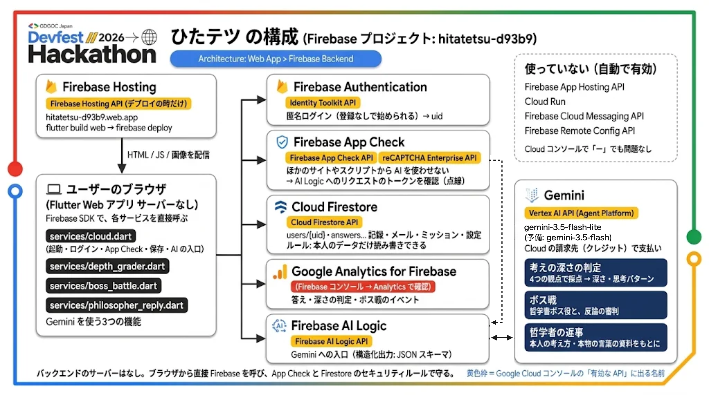

# ひたテツ ～知識を永遠に、ひたすらテツガク～

**▶ 公開URL: https://hitatetsu-d93b9.web.app**（スマホでも PC でも、登録なしで遊べます）

**AIに考えを預けない練習をする、哲学のリール型アプリ。**
答えを教えるAIではなく、「なぜ？」を問い返し、あなたの考えの深さを測るAI。

- DevFest GDGoC Japan Hackathon 2026（カテゴリ: 教育）／チーム t006

## 解決したい課題

調べる前に聞き、考える前にAIに答えをもらう。便利になった一方で、自分で理由を考え、反論と向き合い、言葉にする機会が減っています。
ひたテツは、AIを「答えをくれるもの」ではなく **「考えさせてくれるもの」** として使い、その成長を目に見える形にします。

> テーマ「Own the Why, Build with Intent」— 自分の「なぜ？」を持つ。

## できること

| 機能 | 内容 |
|---|---|
| 考えるリール | 「テセウスの船」「トロッコ問題」「水槽の脳」「自由意志」を、1問ずつ縦スワイプで考える。考える時間があり、すぐには次へ進めない |
| 反論 | 答えを選ぶと、雲が裏返って「反論」が出る。それでも変わらない／少し揺らいだ／考えを変える、で向き合う |
| 考えの深さ（Gemini） | 最後に自分の言葉で書いた考えを、Gemini が4つの観点（理由・反論との向き合い・考えの動き・自分の言葉）で採点。深さ（水面〜海溝）と思考パターンを返す |
| もう一度考える | 答えた問いが10分後に1問ずつ戻ってくる。前の答えは隠したまま答え直し、「さっき → いま」で考えが変わったかを記録 |
| ボス戦（Gemini） | 自分の立場を選び、反対の立場の哲学者ボス（テーマごとに2人: ヘラクレイトス／アリストテレス、カント／ミル、デカルト／ウィトゲンシュタイン、ニーチェ／サルトル）に、理由で反論してダメージを与える。Gemini が審判とボス役。難しさ ★1〜3。1分考えこむと、答えではなく方向だけを示すヒント（★3はなし） |
| やさしく言うと？（Gemini） | 哲学者の言葉やボスのセリフを、中学生にもわかる言葉に言いかえる |
| 哲学者と話す（Gemini） | コメント欄の哲学者が、本人の考え方・本物の言葉の資料をもとに返事をする（言葉や著作のでっち上げを防ぐ） |
| 思考スタイル | 判定の積み重ねから「疑いの探偵」などの型と、考え方の変化（はじめ → いま）を表示 |
| ひたちゃん | 深く考えるともらえる「ちびのう」で、しぼんだ脳の生きものを育てる（プロローグは紙芝居） |
| コピペ防止 | 自分の考えを書く欄では、貼り付けを受けつけない |
| ミッション・メール | デイリー／ウィークリー／マンスリー／アチーブメント のミッションと、報酬が届くメールボックス（まとめて受け取れる） |
| 音 | 画面ごとの BGM（クロスフェードで切り替え）とボタンの効果音。設定で音量を変えられる |

## 使っている Google の技術

| 技術 | 使い方 |
|---|---|
| **Gemini**（Firebase AI Logic / Agent Platform） | 深さの判定・ボス戦・ヒント・言いかえ・哲学者の返事。構造化出力（JSON スキーマ）で、点数や思考パターンをデータとして受け取る |
| **Firebase Hosting** | Web アプリの公開 |
| **Firebase Authentication** | 匿名ログイン（登録なしで始められる） |
| **Cloud Firestore** | 記録・ボス戦・メール・ミッション・答えの記録の保存。セキュリティルールで本人のデータだけ読み書き可 |
| **Google Analytics for Firebase** | 答え・深さの判定・ボス戦・答え直しをイベントとして記録（考える力の変化を分析するため） |
| **Firebase App Check**（reCAPTCHA Enterprise） | 本物のアプリからだけ Gemini を使えるようにする |
| **Flutter** | アプリ全体（Web） |

## 構成



サーバーは持たず、ブラウザ（Flutter Web）から Firebase の各サービスを直接呼ぶ。App Check と Firestore のセキュリティルールで守る。詳しい図: [docs/architecture.png](docs/architecture.png)

```
lib/data/          テーマ・問い（人が書いたもの）・哲学者の資料・ボス・お知らせ
lib/services/      Firebase（cloud.dart）・Gemini（depth_grader / boss_battle / battle_helper / philosopher_reply）・BGM
lib/state/         状態（Riverpod）: 記録・ちびのう・メール・ミッション・思考スタイル・もう一度考える
lib/screens/       画面
lib/widgets/       部品
assets/            画像・フォント・音
tool/              フォントのサブセット化・クレジット生成のスクリプト
firestore.rules    Firestore のセキュリティルール
docs/
  著作物利用シート.md / _提出用.xlsx   使っている画像・フォント・音楽・ライブラリの出典とライセンス
  ひたテツ_問い一覧.docx               すべての問いと反論の一覧
  firebase-setup.md                    Firebase のつなぎ方
```

## 動かし方

```sh
flutter pub get
flutter run -d chrome --dart-define-from-file=.env.local.json   # App Check のデバッグトークン（コミットしない）
```

- デモ用に記録が入った状態で始める: `--dart-define=DEMO_RECORDS=true`
- 公開: `flutter build web --release` → `firebase deploy --only hosting`

## クレジット・ライセンス

画像・フォント・音楽・ライブラリの出典とライセンスは [docs/著作物利用シート.md](docs/著作物利用シート.md)、アプリ内では「設定 → クレジット」。
コードは [MIT License](LICENSE)。画像・フォント・音楽などの素材は MIT ではなく、それぞれのライセンス（著作物利用シート）に従います。
問いのカードはチームが書いたもので、AI は問いを作りません（AI は採点・反論の相手・ヒント・言いかえ・返事に使います）。

---

## DevFest Hackathon 2026 提出用リポジトリ（運営のテンプレート）

DevFest Hackathon 2026 のチームの **最終提出用** リポジトリです。提出期限までに、作品のコードと資料をこのリポジトリに置いてください。

このリポジトリは **公開（public）** です。開催中も、運営・審査員・ほかの参加者が見られます。

## はじめに

1. GitHub から届いた招待を受け入れてください（招待の期限は 7 日です）
2. このリポジトリを clone して、提出物を置いてください

招待の期限が切れたときや、メンバーが変わったときは、運営に連絡してください。

## 開発用のリポジトリは別に作ることをおすすめします

このリポジトリでは **GitHub Actions と GitHub Pages が使えません**。CI やデプロイ、Pages での公開をしたいときは、チームで開発用のリポジトリを別に作ってください。

- 開発用のリポジトリは、チームのメンバーのアカウントや、チームで作った Organization に作ってください
- 開発はそちらで進めて、提出期限までに最終版のコードと資料をこのリポジトリに push してください
- 審査はこのリポジトリの内容で行います。開発用のリポジトリにしかないものは、審査の対象になりません
- デプロイした作品の URL があれば、この README に書いてください

## 秘密情報をコミットしない

API キー・パスワード・サービスアカウントの鍵などは、**絶対にコミットしないでください**。公開リポジトリなので、push
した時点で誰でも見られます。開発用のリポジトリから持ってくるときも、履歴ごと push すると、過去のコミットに含まれる秘密情報も公開されます。

- 秘密情報は `.env` や `.dev.vars` などに書き、コミットしない（`.gitignore` に入れてあります）
- 誤って push したら、すぐにキー（鍵）を無効にして作り直し、運営に連絡してください。履歴から消すだけでは不十分です
- GitHub の push protection が、よく知られた形式のキーの push を止めることがあります。止められたら、そのキーをコミットから外してください

## 提出

提出の方法と締切は、運営からの案内に従ってください。提出期限を過ぎると、このリポジトリは読み取り専用になり、push できなくなります。

## ライセンス

[MIT License](LICENSE) です。ほかのライセンスにしたいときは、LICENSE を書き換えてください。
